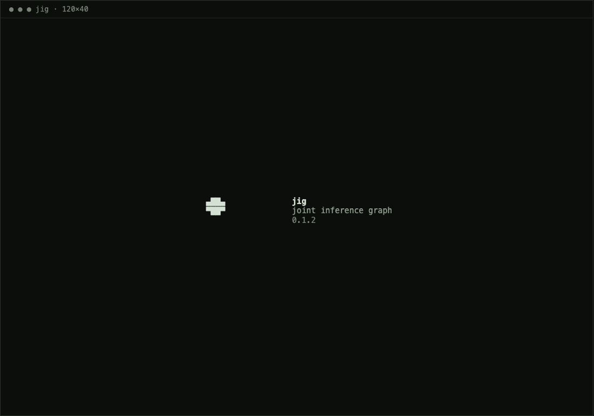

# Changelog

## Unreleased: Jig asks before it acts, and Check looks before it judges

Jig now asks for permission the way Claude Code does. It is as safe as before, and it gets in your way less.

### What you will notice

- **A write shows you its diff and waits.** You can say yes, yes to every edit for the rest of the session, or no.
- **A command asks unless it only reads.** `ls`, `cat`, `grep`, `git status` and a `cd` inside your project just run. Anything else asks, one part at a time, and you can keep its prefix as a rule so it never asks again in this project. Today's flat refusals are gone: a command with a path outside your project or an expansion now asks you, with a warning, instead of being refused.
- **Your no can say what to do instead.** Type it, and the role reads it and goes on. A plain no, or Esc, stops the run.
- **Reading outside your project asks.** Yes can cover that folder for the session, and `/add-dir` or `--add-dir` adds a folder for good.
- **Shift+Tab cycles the mode:** default, accept edits and plan. The footer says which one is on. `--dangerously-skip-permissions` skips the questions for one session; it is never remembered.
- **Rules, as in Claude Code:** `Shell(npm test *)`, `Write(src/**)`, `Read(./.env)`, in your config, your project's `jig.config.json` or `.jig/settings.local.json`. `/permissions` lists and changes them.
- **`jig run` denies what would ask,** since nobody is there to answer, and tells you how to allow it: `--permission-mode acceptEdits`, `--allow` or a rule. If a script of yours relied on `jig run` writing files, add `--permission-mode acceptEdits`.
- **Check looks before it judges.** It runs its own tools on the workspace (it read nothing before and so always said inconclusive), and it sees what changed, measured from the files rather than told by Do. A plain question that changes nothing and has no checks is answered without a verdict, and its outcome reads "not verified" everywhere (the result line, the footer, the run's record), never "inconclusive". `jig run` still exits 1 for it: nothing passed.
- **Commands that take a choice open a picker.** `/topology`, `/models`, `/brains`, `/providers`, `/runs`, `/replay`, `/memory`, `/advisor`, `/sight` and `/permissions` typed alone show their choices, the current one marked: the arrows move, Enter chooses, Esc cancels, and typing filters a long list. With the choice typed after them they act at once, as before (`/replay last` plays the newest run). `/tools` opens a checklist per role, to turn tools off for one role in this session. The printed lists are behind `list`.
- **Answers read as they were written.** Markdown in an answer is drawn in the conversation: headings bold, one list item to a line with a hanging indent, bold as bold, inline code set apart, a fenced block indented under its language, all wrapped to the width. While a run goes on, a role's text shows its first lines as they were written, then how many more there are; `/replay` has it whole. The one-line log of `jig run` takes a text's first line instead of gluing its lines together.
- **Borders and columns stay in line in every terminal.** Some glyphs took two cells in some terminals while Jig counted one: Plan's ☰ (wide since Unicode 16), and in a terminal set to draw "ambiguous" characters wide, most of the rest. Every glyph Jig draws in boxes, arcs, the footer, tables and the log is now one cell wide everywhere, so a few changed: ≣ Plan, ◊ Decide, ▪ measured, ❝ written, ¦ waiting for you, ∙ between facts, ⋯ for a cut, ⇢ for an arrow. The box lines and Jig's own art cannot change, so Jig asks the terminal how wide it draws them when it starts, and draws in ASCII when it draws them wide. Every table pads its columns by what you see, not by characters.
- **Every role knows where it is:** the folder, the date and the system.
- **A file written with `\n` where line breaks should be** is fixed as it is written, and the role is told. Set `"tools": { "unescapeNewlines": false }` in your config to keep it as written.

## Unreleased: Jig has a face

Jig is a small graph that dances: three round nodes and three straight edges, at rest a perfect triangle. It drops in when a session opens, and then it sits in the corner and moves with the work: it hops while a role works, leans to its advisor on a consult, lets an edge go while it waits for you, stretches an edge on a way back, and snaps its base when a check fails. Then it settles back to rest.

### What you will notice

- **The built-in topologies name brains.** A role that produces work (Plan, Do) uses `fast`; one that verifies, judges or advises (Check, Critique, Decide, the Advisor) uses `strong`; a topology of a single role, like the Ralph Loop, keeps `default`. With only Ollama they all run on your local model, as before. Give `fast` and `strong` other models in your config, and the same topology runs on them.
- **A startup.** When a session opens, Jig drops in, draws its edges and hops once, in about two seconds. Any key skips it. It does not play off a terminal or in a small one, `--plain` shows it still, and `"ui": { "startup": false }` in your config (or `JIG_STARTUP=off`) turns it off.
- **Jig in the header.** Once you have sent a task, a smaller Jig sits at the top beside where you are, in the pose of what the engine is doing: idle, the team taking the task, thinking, working, a tool, a consult, waiting for you, a way back, passed, failed. A way back, passed and failed play once and hold.
- **Small marks that say the same.** The footer's first line, the strip and the line above a running answer start with a three-cell mark of the same states; at rest it is `▞▚`, dim.
- **One palette.** Every cell of Jig takes its colour from the same table as the topology: green is running, amber is waiting for you, red is failed, and everything else is ink, dim or faint. `--plain`, 16 colours, light themes and `--ascii` follow from it.

## 0.1.0, 2026-11-19: Jig, and a session in your terminal

The project is called Jig now: a Joint Inference Graph, several models reasoning together, arranged as a graph. The command is `jig`, and with nothing after it, it opens a session in your terminal, the way `claude` does. Each message you send is a task your topology runs.

### What you will notice

- **The command is `jig`, on npm.** `npm install -g jig-console` installs it; the engine is `jig-core`. The old commands `agentic-lab` and `alab` are gone. The entries below this one still say `agentic-lab`, because that is what the command was called then.
- **A session.** `jig` takes the whole terminal. The topology is at the top, live on its grid while a task runs, and Ctrl+T folds it to one line. The conversation is in the middle: your message, then the answer as Do's model writes it, the run's latest steps, and how it ended. The two-line footer is at the bottom.
- **Write as you would in a chat.** Enter sends. Alt+Enter, Ctrl+J or a backslash before Enter start a new line. A paste goes in whole and never sends by itself. The up and down arrows walk your earlier messages.
- **Steer while it runs.** What you type during a run is a note Do reads on its next turn. If the run ends before Do takes another turn, the session tells you the note was not read. Esc stops the run.
- **Commands off the list ask you first.** When a role wants to run a shell program that is not on its allow-list, the session shows you the command: 1 allows it once, 2 allows that exact command for the rest of the session, 3 or Esc says no. Everyday commands like `npm test` become usable without putting `npm` on the list, which would let the role run anything npm can. A path outside your project, an expansion or a program run by its path is refused before you are asked. `jig run` never asks: it refuses, as before.
- **Slash commands**, with Tab to complete: `/topology` lists, draws or switches the topology (a file works too), `/models` gives each role its model, `/tools` shows each role's tools and turns one off, `/sight` measures what each role sees, `/checks` sets the checks for the next task, `/budget` the tokens a task may spend, `/memory` how far recall reaches, `/advisor` the consulted role's model, limit and sight, `/runs` lists past runs and `/replay` plays one on the same screen. `/clear`, `/quit` and `/help` do what they say.
- **Sessions are kept.** `.jig/sessions` holds each session's conversation and settings, and `jig --resume` opens the last one. The conversation so far goes to each new task as its input, and memory is scoped to the session.
- **`.jig/` replaces `.agentic-lab/`.** Runs, sessions and your input history are written there, with a `.gitignore` inside that ignores everything, so your prompts never land in a commit. `.agentic-lab/` is still read.
- **Your settings have a home.** `~/.config/jig/config.json` (or your `XDG_CONFIG_HOME`) holds your own configuration; a project's `jig.config.json` goes over it. `agentic-lab.config.json` is still read.
- **The footer never cuts a name to a stub.** Each role is its glyph and its name. When room runs short, the name becomes its first word, then finished and waiting roles fold under their glyphs, and the clock goes last. You no longer see `crit` or `advi`.
- **A long way-back label no longer covers its arc.** It goes after the arc's corner, whole.

- **Any provider, keys by reference.** Your config names provider entries: Ollama (several hosts if you like), Anthropic, OpenAI, Gemini, OpenRouter, or any server that speaks OpenAI's API, with presets for LM Studio, llama.cpp, vLLM, Jan, Groq, Mistral, DeepSeek and Together. A key is never written by Jig: an entry says where it is, `env:NAME`, `keychain` (your OS keychain) or `command:<program>` (a helper such as `op read` or `pass`, run without a shell). A key you type in goes to the keychain, hidden. A key someone wrote in clear in a config file is still read, with a warning. Keys are taken out of logs, errors, runs and sessions, and each goes only to its own provider. `/providers` in the session, or `jig providers list|add|test|remove`, administers them; a test makes one real call and says how long it took. `/models` lists the models each provider has now, and a role takes any of them as `<entry>/<model>`.
- **Brains, with fallback only when a provider is unavailable.** A brain is a name for a chain of models, such as `strong` or `fast`, and a role can take a brain instead of a model. When the first model's provider is unavailable (no entry or key, the connection refused or timed out, a server error after the retries, a rate limit after its wait, the model not found), the role moves to the next one, stays there for the rest of the run, and the box and footer mark it with ↪; the run's summary says who fell back and why. A bad or empty answer never moves it: that would hide quality. The brains `default`, `strong`, `fast` and `local` come with Jig and resolve to what you have; with only Ollama, they are all your local model. `/brains` and `jig brains list|set|test` say which model would answer now, and `jig doctor` checks everything at once.

### Good to know

- The built-in topologies still name no brain: their roles run on the model the session or `jig run` gives them, which is the `default` brain's first model. A topology file can name a brain or a chain for a role (docs/FORMAT.md).
- An OpenAI-compatible server that ignores streaming is asked again without it, so its answer is not lost.
- The old one-model `jig chat` is gone; the session replaces it. `jig run --topology ralph-loop --task "..."` gives one answer from a script.
- A note still reaches Do only on its next turn, so in a one-round topology a note typed late is not read. The session says so.
- A role waiting for your answer keeps its turn's timeout running (ten minutes by default).
- Topology files keep Jig's extension under `metadata.jig` now. A file written before, under `metadata.agentic_lab`, reads the same, with one warning, and `jig convert` writes it under the new name. [docs/FORMAT.md](docs/FORMAT.md) explains why it moved.
- The answer streams with Ollama, Anthropic and OpenAI-compatible providers. A stream that already showed text is never retried, so nothing is shown twice.
- The logo, the startup animation and the activity marks are placeholders until the design is chosen; they all live in one file, `packages/cli/src/session/theme.ts`.
- The web dashboard is legacy now: Jig is used through the console, and new work is built and proven there first.

### For developers

- The packages are `jig-core` (the engine), `jig-console` (the `jig` command) and `jig-desktop` (the dashboard, private). The first two are ready to publish, each with its README, licence and a build that runs before packing; nothing is published.
- `pg` and `redis` are optional peers of `jig-core`, loaded only when Postgres storage or the Redis event bus is used.
- The engine reports each tool run as it starts and as it ends (`tool:start`, `tool:end`), each piece of an answer as it is written (`text`, with `streamText`), and each question put to you and its answer (`approval:asked`, `approval:answered`).
- `JIG_LOG_LEVEL` replaces `AGENTIC_LAB_LOG_LEVEL`, which is still read.

## Unreleased: a run you can watch, topology files half as long, and a shell on a leash

The terminal view moves now, and you can watch any topology without a model. The topology files are about half as long, and still valid Agent Spec. And three fixes that waited: the shell runs only what a role is allowed, benchmarks stop averaging in the judge's missing scores, and the old single loop is gone.

### What you will notice

- **The run moves while the model thinks.** `agentic-lab run` used to redraw only when something happened, so during a 30-second model call nothing changed. Now the screen redraws a few times a second: the running role's spinner turns and the clock runs. Nothing flickers: each frame is written over the last, row by row.
- **A full screen in fixed regions.** In a terminal the view takes the whole screen, as htop or less do: the drawing at the top, a two-line footer at the bottom, and the log in the rows between. The log never pushes the drawing off the screen: it shows the latest lines that fit, and when the drawing leaves room beside it (a wide terminal), the log goes there, full height. In a short terminal the log becomes one line, the latest event; the drawing keeps priority, falls back to the one-line strip, and when even that does not fit the screen says so. It follows the terminal when you resize it.
- **Scroll the log.** The up and down arrows, PgUp and PgDn scroll the log back while the run goes on; new lines then wait below, and the log's border says how many. End, or scrolling back to the bottom, follows the newest again.
- **Nothing is lost when it ends.** At the end, on Ctrl+C or on an error, you get your terminal and its cursor back, and your scrollback gets the final drawing, the whole log and the footer, then the run's summary. When the output is not a terminal, nothing is redrawn: the log is written as plain lines as it grows, and the final drawing once.
- **The log says what happened,** one line each: a role starting, each model call and the tools it asked for, a verdict marked ■ when the lab measured it or “ when a model wrote it, a decision and its reason, a way back taken, a consultation.
- **The footer says where the run is.** Its first line is the command you typed. Its second has each role with its model and its state in brackets, `do qwen2.5 [running 3/20]`, then the run's figures: the round against its limit, the tokens against your budget, the lab's check with ■, how it ended, and the time. At 80 columns it drops the models, then shortens the names, then folds the finished roles into one `[4 done]`, and never wraps.
- **A consulted role has its own rail.** In the Advisor topology, the Advisor gets a column beside the drawing (below it when the screen is narrow, one line when it is short): its model, whether it is on call or answering, how many times it was asked and how many tokens it read, each consultation with who asked, in which round, and why when they said, and the last advice, marked as written by a model.
- **Each box says its model,** and a bar shows only where there is a real limit: a role's model calls against its tool-call cap. The footer gives the round against its limit and the tokens against the budget as numbers. Colour is still only for a run's state.
- **Watch any topology move.** `agentic-lab show deep-reasoning --play` runs it on a scripted model in a scratch folder: Do writes a file, Check fails the first round and passes the next, Decide sends the work back once, and a role with a consult edge consults. No model, no tokens. Space pauses it, and it plays again and again until you press another key; `--speed 2` plays it twice as fast, and `--once` plays it once.
- **Replay a run.** `agentic-lab replay <run-id>` plays a recorded run on the same screen, at the speed it ran or faster (`--speed 10`), rebuilt from its step records. Space pauses, the right arrow steps, the arrows and PgUp scroll its log, q quits. It reads Postgres when that is where the run was stored; otherwise the run's folder, where the CLI now keeps the steps of a run whose storage was in memory.
- **Topology files about half as long.** Deep Reasoning went from 1,234 lines to 600. Every component was already written once and referenced; what repeated was each node's inputs and outputs, which Agent Spec lets a file leave out because it infers them (a node's from its agent, a counter's from its subflow). The lab now writes that compact form, and reads both. `agentic-lab convert --expanded` writes the full form. Oracle's own reader, pyagentspec 26.3.1, reads the compact files exactly as the full ones.
- **The shell runs only what a role may run.** It used to block a list of dangerous commands, and `rm -rf ~`, `rm -rf ..`, `curl ... | bash` and any interpreter got through, as did a working directory outside the workspace. Now every program must be on the role's allow-list, and every argument, redirection and working directory must stay inside the workspace. The default list reads, compares and arranges files: no interpreter, package manager or network tool. A role that needs more names them in its definition (`config.toolPolicy.commands`).
- **Benchmarks count a missing score apart.** A judge that could not score an answer gave -1, and that -1 was averaged in. Now the average is of the scores the judge gave, and the others are counted and shown beside it.

### Good to know

- A task that needs to run tests, a build or a script needs those programs on Do's allow-list (`config.toolPolicy.commands`). Adding an interpreter or a package manager lets the role run anything that program can, so the allow-list is only as narrow as the programs you add.
- The compact topology files lean on Agent Spec's inference. The specification says an SDK's export always lists a node's inputs and outputs; pyagentspec reads either form the same, and `convert --expanded` writes the full one if another tool wants it.
- A replay can only show what the steps recorded: a note you sent mid-run, or the reason a round ended, are not in them, so a replay leaves them out.
- The terminal tests run the CLI in a real pseudo-terminal, through `script` and through Python's `pty` module; where either is missing, its tests are skipped.

### Also changed

- The engine reports each model call as it ends (`call` events), the limits a run runs with, where a verdict and a decision came from, and the advice a consulted role gave. A stored run keeps its limits.
- The legacy `AgenticLoop` is removed. Nothing used it since the chat, the builder, the CLI and the benchmarks moved to `AgentSession`.

## Unreleased: topologies are files, a role can consult another, and the CLI draws them

A topology is now a file you can read, diff and share. It is a valid Agent Spec 26.3.1 document, the open format Oracle publishes, so other tools can read it too. What Agent Spec has no words for (what each role sees, where each value comes from, the conditions and limits of each way back) sits in one block of its metadata. [docs/FORMAT.md](docs/FORMAT.md) explains it all.

### What you will notice

- **The built-in topologies are files.** They are in `packages/core/topologies`, in YAML, each with a JSON twin. The lab reads them through one formats module, and the dashboard's recipes come from them. They behave as before: the same roles, wires and limits, and the same measured walls.
- **Critique in Deep Reasoning reads Do's tokens.** It used to count tokens with no wire to bring them, so it always saw 0. Now a wire does. Nothing else it sees changed.
- **JSON or YAML, as you like.** The lab reads and writes both, and a YAML file and its JSON twin are the same document.
- **Errors say where.** A broken file is refused with the exact path to the problem and its line, checked against Agent Spec's own schema, the rules its specification adds, and the lab's extension.
- **You can import a document written elsewhere.** A plain Agent Spec flow or agent becomes a topology: its agents become Do roles, a branch that goes back becomes a way back, and a way back with no limit stops after five rounds. The import tells you what it could not keep.
- **You can export for another runtime.** A file the lab writes is already Agent Spec. The lab tells you what another runtime will ignore, such as the walls and provenance. The round limit is kept: each way back goes through a counter in the flow itself.
- **A role can consult another.** A consult edge gives a role a tool it calls when it decides to, a few times a turn at most. The edge says what the consulted role sees: your task, the caller's question, its whole turn so far, only its tools' results, or the lab's check run at that moment. Each consultation is recorded as a step of its own.
- **The Advisor topology is built in.** Do works on your task and asks an Advisor when it wants, 3 times a turn at most. With an Anthropic model and the Advisor's full sight, the lab uses Anthropic's own advisor tool; advice that comes back encrypted is stored as sealed. With any other model, the lab plays the advisor itself.
- **The CLI draws.** `agentic-lab show deep-reasoning` draws a topology at rest; `--sight` adds what each role sees, measured with a mock model. `agentic-lab run` draws the run as it goes, in the terminal, with colour only for what is running, failed or waiting for you. Below 80 columns it draws a single line. `--no-live` gives you the old lines, and `--frames <file>` keeps every frame.
- **New commands.** `agentic-lab validate <file>` checks a definition. `agentic-lab convert <file>` turns it into JSON or YAML, or into an old-style recipe, and tells you what is lost. `run --topology` takes a file too.

### Good to know

- Your saved builder recipes still load: the old recipe shape is read for migration.
- The real advisor tool was checked only against a mocked Anthropic API. Its call limit counts per request, so a turn of several requests can consult more often than the topology's limit.
- In our two runs on qwen2.5:7b, Do consulted the Advisor only when the task asked it to, and the Advisor, the same 7B model, described the work instead of advising on it. Whether an advisor helps is an experiment for later.

## Unreleased: what each role saw, and checks no role can touch

Every run now keeps what each role saw and where each value came from. And when your task says how to check it, the lab checks it itself, somewhere no role can write, and the run's outcome is that check's.

### What you will notice

- **A task can carry its checks.** A command that must exit 0, a file that must hold an expected text, or an expected answer. In the CLI that's `--check "sh test.sh"`, `--check-file test.sh` and `--task-file task.json`. The chat and the builder take `checks` and `checkFiles` in the request.
- **The lab runs the checks, not a role.** It copies your workspace into a directory of its own, puts the check files back as they were when the run started, and runs the checks there. If a role edits your test script, nothing changes: the lab uses its own copy.
- **With checks, the outcome is the check's.** A run passes when the measured check passes, and fails when it fails, whatever the roles concluded. The topology's own outcome is still shown beside it, so you can see when they disagree.
- **Check's verdict follows the measured check.** When there are checks, Check runs them through the lab on its turn, and its verdict is their result. What its model said is kept beside it, marked as written by a model. A model that hides its verdict in a tool call, or never gives one, no longer decides the round. To compare the two, set `verdictFrom: "model"` (`--verdict-from model`): the model's verdict drives the run again, and the outcome is still the lab's check.
- **Plan and Check only read.** In every built-in topology, Do is the only role that can write files, run commands or use git. Plan and Check get `file_read`, `glob` and `grep`. Critique, Decide and Memory get no tools. A skill can't give Check a way to write. You can still give a role other tools in its definition, on purpose.
- **A role sees only what its wires give it.** Roles no longer get every recent signal and the shared blackboard. The wires to Critique and Decide carry counts and verdicts, never the text of the work. The task, the conversation and recalled memories reach Plan, Do and Check, as before, and nobody else.
- **Every value has a provenance.** Each field a role sees is marked as from you, measured by the lab, or written by a model. A pass rate counted from a model's verdicts is written; counted from the measured check, it's measured.
- **Every role's turn is recorded.** What it was given and where each value came from, the exact messages sent to its model and the replies, the tools offered, what it emitted, its tokens and time. They're in the `run_steps` table and in `GET /api/runs/<id>`. `run --verbose` prints what each role saw. A recorded run can be replayed and sends the same prompts.
- **What each role sees is measured.** `measureSight(topology)` runs a topology with a mock model and marked inputs and tells you, for each role, what reached its prompt, what reached it unread, and what never reached it. The built-in topologies' results are in `packages/core/src/engine/__sight__`, and a test fails when one moves.
- **A token budget.** `tokenBudget` (`--token-budget`) caps what one attempt may spend. When it's spent, the calls in flight stop and the run ends.

### Also changed

- **Memory stays with its task.** The chat recalls from the current conversation by default, not from every conversation. You can ask for runs of the same task, every conversation, or nothing (`memoryScope`). Benchmarks recall nothing unless you pick a memory bank.
- **Ollama gets a bigger context.** Each call asks for 16,384 tokens of context (`num_ctx`). Before, Ollama used its small default and quietly cut long tool loops from the start. Set `OLLAMA_NUM_CTX` to change it. The CLI prints the number it uses.
- **Benchmarks run in the lab's own process.** The baseline is one direct call with the question alone, and the judge is a model you can name apart from the contenders' (`judge`, or the field on the benchmarks page). Nothing goes over HTTP to another server anymore.

## Unreleased: one engine, and it does what the definitions say

The chat, the builder, the CLI and the benchmarks now run on one engine. Before, the chat had its own copy of every recipe, the builder ran the core engine, and the CLI ran an older loop. They did not agree, and half of what the recipes said did not happen. Now each surface is a thin adapter over `AgentSession`, and the same run gives the same events wherever you start it.

### What you will notice

- **Critique no longer reads Do's output in the chat.** In the chat, Critique used to get the last few messages, Do's answer included. That was the opposite of what the definition says. Now it follows the definition: it sees the process (verdicts, tool counts, tokens), not the work. If you relied on Critique commenting on the answer itself, it won't anymore.
- **Every built-in recipe runs.** Deep Reasoning, Supervised Coder and Adversarial Duel used to fail before their first step. A node now gets the ports its recipe declares, and a wire that can never deliver anything is refused when you build the pipeline.
- **Roles run in the order you see.** A run goes in rounds. Each round runs the roles in their drawn order: in Deep Reasoning that's Plan, Do, Check, Critique, Decide. When Decide sends the work back, the next round starts where it points: at Do to fix things, at Plan to start over. Critique runs every round.
- **Ways back carry something.** When Check or Decide sends the work back, Do now reads their corrections, along with its own previous answer. When Decide starts over, Plan reads the task and the reason.
- **"Done" means done.** When Decide converges, the run stops. The round limit counts the rounds you actually ran.
- **No verdict is not a pass.** A round without a verdict is inconclusive. A verdict counts once. Partial, inconclusive or unreadable verdicts never count as passing.
- **Success is honest.** A run ends as passed, failed, inconclusive or stopped. You only see success when it passed. A run where a role failed, or where nothing ever checked the work, is not a success. The chat, the builder, the stored run and the CLI's exit code all say the same.
- **The Ralph Loop really loops.** It takes one turn, then another, while `PLAN.md` still has unchecked items, up to 20 turns. With no plan file it takes one turn and claims nothing.
- **Steering goes to Do.** A nudge from the chat is now a note Do reads on its next turn. No other role sees it. Priority is shown as a label in the note; it doesn't change when the note arrives.
- **The chat shows a role's output when the role finishes.** It used to stream tokens as the old copy of the loops wrote them. Now each role's step fills in when that role's turn ends.
- **Limits are rounds now.** The built-in recipes stop after 5 rounds at most (the Adversarial Duel after 3, the Ralph Loop after 20 turns). Deep Reasoning's Decide still stops at its own 3.

### The CLI

- `agentic-lab run` runs a topology through the same engine. Without `--topology` it runs the Ralph Loop. The task is `--task "..."`, or your `PROMPT.md`.
- `recipes --run` and `pipeline --recipe` work again. They used to crash on `requires parameter "tools"`.
- `--json` prints every engine event as one JSON line.
- The exit code tells you how it went: 0 when the run passed, 1 when it didn't, 130 when you stopped it.
- Ctrl+C stops the run and the model call in flight. Press it twice to quit at once.
- `--auto-commit`, `--auto-push` and `--log` are gone. Only the old loop honoured them, and keeping them would mean ignoring them quietly.

### Robustness

- Every model call has an output limit (4096 tokens unless you set one) and a timeout (300 seconds unless you set one). A call can't hang for minutes anymore.
- Stopping a run aborts the calls in flight, in every provider.
- Hitting a tool-call cap, or a model call that fails, ends the run as failed and says why. A tool error is still just feedback to the model.

### Security, first step

- The dashboard listens on 127.0.0.1 by default. To reach it from another machine you have to say so (`npx next dev --hostname 0.0.0.0`), and the API still has no authentication, so think twice.
- Commands the agent runs through the shell and git tools no longer inherit the server's environment. Your API keys and database URLs stay out of them.
- Token authentication and sandboxed tools come later.
