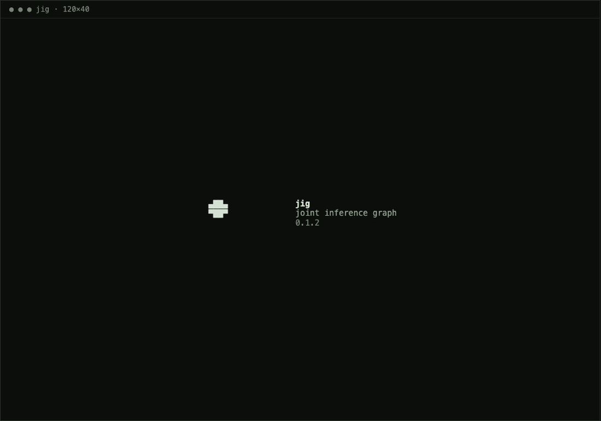

# Jig



> A Joint Inference Graph: several models reasoning together, arranged as a graph you define. You use it as your own harness for real work, and as an instrument that measures which topologies work.

Jig was called Jig. The repository keeps that name for now; it is renamed when this work reaches main.

Inspired by the [**"Human On the Loop"**](https://dotnetting.net/2026/02/the-human-on-the-loop-a-practical-guide-to-agentic-engineering/) agentic engineering pattern (Ralph Loop) by Lester Sanchez.

> **What's new:** `jig` with no command opens a session in your terminal, like `claude` does. Each message is a task your topology runs: the answer streams in, the topology moves on its grid above, typing during a run steers it, and a shell command off a role's list asks you first. Slash commands change the topology, a role's model, the checks, the budget, memory and the advisor, and replay a past run on the same screen. `jig --resume` opens the last session again. The subcommands stay for scripts. See [CHANGELOG.md](CHANGELOG.md).

---

## 🎯 What is this?

Jig grew out of a **modular experimentation platform** for running AI agents in iterative loops. The core idea of its smallest topology, the Ralph Loop:

```
while hasTasksRemaining:
    agent reads specs + plan → picks ONE task → works on it → updates plan → ends turn
```

Each iteration is **stateless** — the agent gets fresh context every time, solving the context window dilution problem. The agent doesn't know it's in a loop.

### The 4 Pillars

| Pillar                | What                                           | File             |
|-----------------------|------------------------------------------------|------------------|
| **1. Specs**          | What to build — requirements & constraints     | `specs/SPEC.md`  |
| **2. Plan**           | Living TODO list — agent reads, picks, updates | `PLAN.md`        |
| **3. Prompt**         | Static instructions — how to behave each turn  | `PROMPT.md`      |
| **4. Brain + Muscle** | LLM (brain) + Tools (muscle)                   | Provider + Tools |

---

## 📦 Architecture

Monorepo with 3 packages:

```
agentic-lab/
├── packages/
│   ├── core/          # jig-core: the engine, AgentSession, formats, grid, providers, tools (publishable)
│   ├── cli/           # jig-console: the jig command, a session and the subcommands (publishable)
│   └── web/           # jig-desktop: the legacy dashboard (Next.js, private)
├── infra/             # 🐳 Infrastructure configs (PostgreSQL, Prometheus, Grafana)
├── docs/              # 📖 Documentation
├── docker-compose.yml # Full infrastructure stack
├── package.json       # Workspace root
├── tsconfig.base.json # Shared TypeScript config
└── .env.example       # Environment template
```

---

## 🚀 Quick Start

### One Command Setup

```bash
cd agentic-lab
./setup.sh          # Installs, builds, starts infrastructure (~60s)
```

> See `./setup.sh --help` for modes: `--full` (all services), `--dev` (default), `--minimal` (no Docker).

📖 **Full guide with troubleshooting:** [docs/QUICKSTART.md](docs/QUICKSTART.md)

### Manual Setup

#### 1. Install dependencies

```bash
cd agentic-lab
npm install
```

#### 2. Build Jig and put `jig` on your PATH

```bash
npm run build:core
npm run build:cli

# Once: make the jig command available in any directory
cd packages/cli && npm link && cd ../..
```

Jig is not on npm yet: today you install it from source, and the link points the `jig` command at this checkout. Publishing `jig-core` (the engine) and `jig-console` (the `jig` command) is planned; until then `npm i -g jig-console` will not find anything. The old names `agentic-lab` and `alab` still run it, with a warning, for a while.

Then, in any project:

```bash
jig                 # a session: each message is a task, /help lists the commands
jig --resume        # the last session in this directory, again
```

Jig keeps its runs, sessions and history in `.jig/` in the directory you run it in, with a `.gitignore` inside that ignores everything, so a repository never commits your prompts. Your own settings go in `~/.config/jig/config.json`; a project can add a `jig.config.json`.

#### 3. Start infrastructure (optional)

```bash
npm run infra:up    # PostgreSQL + Redis + Qdrant
```

#### 4. Initialize a workspace

```bash
# In your target project directory:
jig init

# Or with the advanced prompt template:
jig init --template advanced
```

This creates:
- `PROMPT.md` — Agent instructions
- `PLAN.md` — Implementation plan
- `specs/SPEC.md` — Project specifications

#### 5. Configure your LLM

```bash
cp .env.example .env
# Edit .env with your provider settings
```

#### 6. Run the loop

```bash
# The Ralph Loop on your PROMPT.md, with Ollama (local, free)
jig run --provider ollama --model llama3.1

# Another topology, on a task you type
jig run --topology deep-reasoning --task "Fix the failing test in src/sum.ts"

# With OpenAI
jig run --provider openai --model gpt-4o

# With Anthropic
jig run --provider anthropic --model claude-sonnet-4-20250514

# With OpenRouter (100+ models)
jig run --provider openrouter --model anthropic/claude-sonnet-4-20250514
```

---

## ⌨️ The session

`jig` opens a full-screen session. From the top: the topology on its grid, live while a task runs (Ctrl+T folds it to one line); the conversation, where each answer streams in as Do's model writes it, with the run's latest steps under it; the input; and the two-line footer with each role's state.

- **Enter** sends. **Alt+Enter**, **Ctrl+J** or a backslash before Enter start a new line. A paste goes in whole. **↑ ↓** walk the history. **Esc** stops a run.
- **Typing while a run goes** sends a note Do reads on its next turn, through the same steering path as the web.
- **Jig asks before it acts**, as Claude Code does: a write shows its diff, a command its warning, a read outside your project where it is. Shift+Tab cycles the permission mode. See [Permissions](#permissions).
- **A command that takes a choice opens a picker when called alone** (arrows, Enter, Esc, the current value marked, typing filters a long list) and acts at once when given the choice: `/topology` picks, `/topology advisor` switches. `/tools` is a checklist per role.
- **Slash commands**, completed with Tab: `/topology` (pick, list, show, switch, or a file), `/models` (a model per role, `<entry>/<model>`), `/tools`, `/permissions`, `/add-dir`, `/sight`, `/checks` (checks for the next task), `/budget`, `/memory`, `/advisor`, `/runs`, `/replay` (a past run on the same screen), `/clear`, `/quit` and `/help`.
- **Sessions** are kept in `.jig/sessions`; `jig --resume` reopens the last one with its conversation and settings.
- **Providers and brains:** `/providers` lists, adds, tests and removes provider entries, `/brains` the named chains of models, and `/models` gives a role either one. See below.
- `--plain` draws with no colour or style, and `--ascii` with ASCII only. Colour only ever means a run's state.

### Providers, keys and brains

Your `~/.config/jig/config.json` names your provider entries, and a key is always a reference, never the key:

```json
{
  "providers": {
    "ollama": { "baseUrl": "http://localhost:11434", "defaultModel": "qwen2.5:7b" },
    "claude": { "kind": "anthropic", "key": "keychain", "defaultModel": "claude-sonnet-4-20250514" },
    "groq": { "preset": "groq" },
    "studio": { "preset": "lmstudio" }
  },
  "brains": { "strong": ["claude/claude-sonnet-4-20250514", "ollama/qwen2.5:14b"] }
}
```

A key is `env:NAME`, `keychain` (your OS keychain; `jig providers add claude --kind anthropic --keychain` asks for it, hidden) or `command:<program>` (`command:op read op://dev/anthropic/key`, run without a shell). A role names a model as `<entry>/<model>`, or a brain; on a brain it falls back along the chain only when a provider is unavailable, and the screen marks it with ↪. `jig doctor` shows each provider, whether its key is there (never the key), and which model each brain would answer with now.

### Permissions

Jig decides every tool call a role makes before it runs, the way Claude Code does, so it is as safe and no more restrictive.

- **Reads** inside the working directories run without asking. A read outside asks, and its second choice allows that folder for the rest of the session.
- **Writes** ask, with the diff of what would change: Yes, Yes and allow all edits for the session (Shift+Tab), or No. A write outside the working directories, or into a protected path (`.git`, `.jig`, `.claude`, `.vscode`, `.husky`, your shell's and package managers' config files, and the rest of Claude Code's list), always asks, with a warning and no wider yes.
- **Shell commands** run without asking when every part is read-only (`ls`, `cat`, `grep`, `git status`, `git diff`, a `cd` inside, and the like) or allowed by a rule. Anything else asks, part by part: `npm test && rm -rf build` asks about both. The second choice keeps the command's prefix as a rule for the project (`npm test *`, `npm run build *`, `python3 app.py *`), offered only when the prefix names everything it would allow: never for `node -e` or a command with an expansion. A command with an expansion, a path outside or a program run by its path asks with a warning. The shell still runs with a clean environment: your keys never reach it.
- **No** opens a field for what to do instead, and the role reads it and goes on. A plain No, or Esc, stops the run. Tab adds words to a Yes too.
- **Modes**, cycled with Shift+Tab and named in the footer: default (asks as above), accept edits (writes, and `mkdir`, `touch`, `mv`, `cp` inside the working directories, run without asking), and plan (reads and read-only commands only; everything else is refused). `--dangerously-skip-permissions` bypasses the prompts for one session or run, except deny rules, ask rules and a dangerous removal (`rm -rf /`, your home, the project itself), which always ask. Bypass is never a remembered setting.
- **Rules** take Claude Code's shape: `Shell(npm test *)`, `Write(src/**)`, `Read(./.env)`, with `Bash` and `Edit` read as `Shell` and `Write`. Paths are `./relative`, `/from-the-project`, `~/home` or `//absolute`. Deny wins over ask and ask over allow, whichever file a rule is in. A `Read` deny also stops writing that file, and it holds for the files a command names: `cat .env` is denied by `Read(./.env)`.
- **Where rules live:** your `~/.config/jig/config.json`, the project's `jig.config.json` (shared with the repository), and `.jig/settings.local.json` (yours, ignored by git), each as `"permissions": { "allow": [], "ask": [], "deny": [], "defaultMode": "acceptEdits", "additionalDirectories": [] }`. `/permissions` lists them with the file each comes from and adds or removes a rule in the local file; `/add-dir` and `--add-dir` add a working directory.
- **A topology never grants more than you do.** Its roles' tool lists limit what a role may attempt; only your rules and your answers allow it.
- **`jig run` has nobody to ask,** so what would ask is denied, and the run ends saying what was denied and how to allow it: `--permission-mode acceptEdits`, `--allow 'Shell(npm test *)'`, `--deny 'Shell(git push *)'`, or a rule in a config file.
- **Every decision is recorded** on the role's step, yours as given and a rule's or the mode's as measured, and a replay shows them.

Where Jig differs from Claude Code, and why:

- Bypass is only ever `--dangerously-skip-permissions`; Claude Code also takes `defaultMode` and `--permission-mode bypassPermissions`. The author's choice: skipping every prompt should be a decision made each time.
- There is no auto mode (Claude Code's classifier) and no `dontAsk` mode; `jig run` behaves as `dontAsk`. A session starts in the default mode.
- The footer names a mode only when it is not the default, to keep the footer short; Claude Code also shows "manual mode on".
- Choosing No opens the words field at once (Enter on an empty field is a plain no); in Claude Code, No answers at once and Tab opens the field.
- Rules kept from a prompt go to `.jig/settings.local.json` in the folder Jig runs in, not to the git root's `.claude/settings.local.json`.
- A bare `Shell` deny rule refuses every command, but the tool stays in the role's list; in Claude Code it removes the tool from the model's view.
- Jig's built-in read-only commands are a shorter list than Claude Code's, so a few commands Claude Code runs freely ask here. Plan mode only enforces: it does not change what the role is asked to do, as Claude Code's planning flow does.
- There are no managed settings, hooks or sandbox, and no WebFetch or MCP rules (Jig has no such tools yet).

## ⌨️ CLI Commands

| Command                 | Description                               |
|-------------------------|-------------------------------------------|
| `jig`                   | A session: each message is a task the topology runs, drawn live above the conversation; `--resume` opens the last one |
| `jig run`               | Run a topology on a task (Ralph Loop by default), drawn live |
| `jig show`              | Draw a topology at rest; `--sight` adds what each role sees; `--play` runs it on a scripted model, no tokens |
| `jig replay`            | Play a recorded run on its screen, from its step records: space pauses, → steps, q quits |
| `jig validate`          | Check a definition file, with every problem at its path and line |
| `jig convert`           | Convert a definition between Agent Spec and recipes, JSON and YAML |
| `jig pipeline`          | Run or inspect composable pipelines       |
| `jig recipes`           | Browse, inspect, and run built-in recipes |
| `jig config`            | Show and validate configuration           |
| `jig init`              | Initialize a new workspace                |
| `jig status`            | Show workspace status                     |
| `jig providers`         | List and test LLM providers               |
| `jig history`           | Show past run history                     |

### Run Options

```
Options:
  -t, --topology <id|file> Topology to run: a built-in id or a .yaml/.json file (default: ralph-loop)
  --task <text>             The task (default: the prompt file's contents)
  -p, --provider <name>     LLM provider (ollama, openai, anthropic, openrouter)
  -m, --model <name>        Model to use
  -i, --iterations <n>      Round limit (turns, for the Ralph Loop)
  -d, --delay <ms>          Pause between rounds
  --prompt <file>           Prompt file the task is read from (default: PROMPT.md)
  --plan <file>             Plan file (default: PLAN.md)
  --specs <dir>             Specs directory
  --dir <path>              Working directory
  --param <key=value>       Topology parameter (repeatable)
  --json                    Print every engine event as a JSON line
  -v, --verbose             Verbose output
  --temperature <n>         LLM temperature
  --max-tokens <n>          Max tokens per call
  --tools <names>           Comma-separated list of tools
  --live / --no-live        Draw the run on its grid (the default in a terminal) or print lines
  --frames <file>           Write every event's frame of the live view to a file
  --record <file>           Write every frame drawn, clock ticks included, with its time (JSON lines)
  --layout <name>           auto, horizontal, vertical or strip
  --width <n>               Columns to draw for
  --plain                   No colour
  --permission-mode <mode>  default, acceptEdits or plan: with nobody to ask, what would ask is denied
  --allow <rule>            Allow a tool call for this run, as 'Shell(npm test *)' (repeatable)
  --deny <rule>             Deny a tool call for this run, as 'Read(./.env)' (repeatable)
  --add-dir <path>          Another working directory (repeatable)
  --dangerously-skip-permissions  Allow every tool call but deny rules, ask rules and dangerous removals
```

`run`, `recipes --run` and `pipeline --recipe` all run through the same engine as the dashboard, and all take the permission flags. The exit code is 0 when the run passed, 1 when it didn't, and 130 when you stopped it. Ctrl+C stops the run and the model call in flight; press it twice to quit at once.

In a terminal, a run is drawn full screen, in fixed regions: the drawing at the top (each box with its model, the running role's spinner and its model calls against the tool-call cap, a consulted role's rail beside it), a two-line footer at the bottom (the command you typed; then each role's state in brackets, the round against its limit, the tokens against the budget, the lab's check and the time), and the log of what happened in the rows between, which never pushes the drawing. It moves while a model call is pending and follows the terminal's size. The arrows, PgUp and PgDn scroll the log back while the run goes on, and End follows the newest lines again. You get your terminal back when the run ends, and your scrollback gets the final drawing, the whole log and the summary. Off a terminal, the log is written as plain lines. `jig show <topology> --play` draws the same screen for a dry run on a scripted model, so you can watch any topology move without a model; `jig replay <run-id>` plays a recorded run on it, from Postgres when it is configured, or from the run's folder, where the CLI keeps the steps of a run whose storage was in memory.

---

## 🔌 LLM Providers

| Provider       | Type  | Tool Calling    | Setup                                 |
|----------------|-------|-----------------|---------------------------------------|
| **Ollama**     | Local | ✅ (most models) | `brew install ollama && ollama serve` |
| **OpenAI**     | Cloud | ✅               | Set `OPENAI_API_KEY`                  |
| **Anthropic**  | Cloud | ✅               | Set `ANTHROPIC_API_KEY`               |
| **OpenRouter** | Cloud | ✅               | Set `OPENROUTER_API_KEY`              |
| **Google**     | Cloud | ✅               | Set `GOOGLE_API_KEY`                  |

### Adding Custom Providers

```typescript
import { registerProvider, type LLMProvider, type LLMProviderConfig } from 'jig-core';

class MyProvider implements LLMProvider {
  readonly name = 'my-provider';
  // ... implement chat(), listModels(), healthCheck()
}

registerProvider('my-provider', MyProvider);
```

---

## 🔧 Built-in Tools

| Tool         | Description                                     |
|--------------|-------------------------------------------------|
| `file_read`  | Read file contents (with optional line ranges)  |
| `file_write` | Write/append to files (creates dirs)            |
| `shell`      | Run a command: read-only ones run, anything else asks you ([Permissions](#permissions)) |
| `glob`       | Find files by pattern                           |
| `grep`       | Search text in files                            |
| `git`        | Git operations (status, add, commit, diff, log) |

### Adding Custom Tools

```typescript
import type { AgentTool, ToolContext } from 'jig-core';

const myTool: AgentTool = {
  definition: {
    name: 'my_tool',
    description: 'Does something useful',
    parameters: {
      type: 'object',
      properties: {
        input: { type: 'string', description: 'The input' },
      },
      required: ['input'],
    },
  },
  async execute(args, context) {
    // Your tool logic here
    return `Result: ${args.input}`;
  },
};
```

---

## 🧩 Composable Loop Engine

Beyond the basic Ralph Loop, Jig includes a **composable pipeline engine** that lets you wire together specialized loops into custom architectures. Each loop occupies a unique epistemic role:

| Loop           | Category     | Epistemic Role                                               |
|----------------|--------------|--------------------------------------------------------------|
| **Execution**  | `execution`  | Produces artifacts via tool calls                            |
| **Evaluation** | `evaluation` | Verifies output against ground truth                         |
| **Planning**   | `planning`   | Strategic reasoning over aggregated signals                  |
| **Refinement** | `refinement` | Convergence gate — decides to converge, refine, or backtrack |
| **Critic**     | `critic`     | Adversarial monitoring via structural analysis               |
| **Memory**     | `memory`     | Lossless information compression                             |

Loops communicate through **typed signals** flowing through ports and wires — no unstructured natural-language conversations between agents.

### Built-in Recipes

| Recipe                 | Loops                                | Use Case                                        |
|------------------------|--------------------------------------|-------------------------------------------------|
| **Ralph Loop**         | Execution                            | Baseline — single-loop, no verification         |
| **Execute & Evaluate** | Execution → Evaluation               | Ground truth verification with feedback         |
| **Supervised Coder**   | Planning → Execution → Evaluation    | Team simulation: Tech Lead + Dev + Reviewer     |
| **Adversarial Duel**   | 2× Execution + Evaluation + Planning | Two agents compete, Arbiter picks the best      |
| **Full Pipeline**      | Plan, Exec, Eval, Critic, Memory     | Maximum epistemic coverage                      |
| **Deep Reasoning**     | Plan → Exec → Eval → Refine ↔ Critic | Iterative refinement with convergence detection |
| **Advisor**            | Execution, consulting an Advisor     | Do asks an Advisor when it wants, 3 times a turn at most |

Each built-in topology is a definition file in `packages/core/topologies`: an Agent Spec 26.3.1 document with the lab's extension, in YAML, with a JSON twin written from it. [docs/FORMAT.md](docs/FORMAT.md) explains the format, how to import a document written elsewhere, and what another Agent Spec runtime makes of the lab's files.

### Deep Reasoning Pipeline

The most advanced built-in recipe. It implements a closed-feedback architecture:

```
┌──────────┐    ┌───────────┐    ┌────────────┐
│ Planning │───▶│ Execution │───▶│ Evaluation │
└──────────┘    └───────────┘    └────────────┘
     ▲               ▲  │              │
     │               │  │              ▼
     │               │  │       ┌────────────┐
     │               │  └──────▶│   Critic   │
     │               │          └────────────┘
     │               │                 │
     │          corrections            ▼
     │               │       ┌──────────────────┐
     │               └───────│   Refinement     │
     │   replan_signal       │   (convergence   │
     └───────────────────────│    gate)          │
                             └──────────────────┘
```

The **Refinement gate** inspects evaluation metrics and critic findings, then decides:
- **Converge** — quality threshold met, stop iterating
- **Refine** — send corrections back to Execution
- **Backtrack** — re-plan from scratch (when stuck in a loop)

Default settings: convergence threshold 70%, max 3 rounds.

### How a run goes

A run goes in rounds. Each round runs the roles in their drawn order, the order the recipe lists them. A wire to an earlier role is a way back. At the end of a round the deciding role chooses what happens next: Decide when the topology has one, otherwise the last Check. A Check that passes ends the run. A way back starts the next round where it points: corrections go to Do, a reason to start over goes to Plan. No way back ends the run. The Ralph Loop is the exception: it takes another turn while `PLAN.md` has unchecked items, up to 20.

A run ends as passed, failed, inconclusive or stopped. It only counts as a success when it passed: the last verdict passed (or the plan was finished) and no role failed. A round with no verdict is inconclusive, never a pass.

A task can carry its checks: a command that must exit 0, a file that must hold an expected text, or an expected answer (`--check`, `--check-file` and `--task-file` in the CLI; `checks` in the API). The lab runs them itself, in a copy of the workspace no role can write, with the check files put back as they were when the run started. When a task has checks, Check's verdict is their result, its model's verdict is kept beside it, and the run's outcome is the final measured check's. Each role's turn is recorded: what it saw, where each value came from (from you, measured by the lab, or written by a model), and the exact messages sent to its model.

📖 See [docs/FOUNDATIONS.md](docs/FOUNDATIONS.md) for the epistemic theory behind each loop.

---

## 🌐 Web Dashboard (legacy)

The dashboard in `packages/web` (jig-desktop) is legacy: Jig is used through the console, `jig`, and every new feature is built and proven there first. A desktop-style app may follow at the end, only if it is worth it; until then the dashboard is kept as it is.

```bash
npm run dev:web
# → http://localhost:3000 (it listens on 127.0.0.1 only)
```

The dashboard listens on your machine only. The API has no authentication yet, so if you open it to the network (`npx next dev --hostname 0.0.0.0` in `packages/web`), anyone who can reach it can run an agent with a shell.

### Pages

| Page           | Path          | Description                                                    |
|----------------|---------------|----------------------------------------------------------------|
| **Dashboard**  | `/`           | Overview with loop statistics and recent activity              |
| **Chat**       | `/chat`       | Dual-mode interface (Chat + Agent) with memory bank selection  |
| **Pipelines**  | `/pipelines`  | Visual pipeline editor with recipe loading                     |
| **Recipes**    | `/recipes`    | Browse built-in pipeline recipes                               |
| **Runs**       | `/runs`       | Run history with status filters, cancel/archive actions        |
| **Memory**     | `/memories`   | Semantic memory explorer — namespaces, search, create, delete  |
| **Benchmarks** | `/benchmarks` | Compare agentic architectures against a curated problem bank   |
| **Providers**  | `/providers`  | LLM provider configuration and testing                         |
| **Settings**   | `/settings`   | System settings and preferences                                |

### Chat Interface

The Chat page supports two interaction modes:

- **Chat Mode** — Direct conversation with the LLM (streaming via SSE)
- **Agent Mode** — Full agentic task execution with a selectable recipe pipeline

Both modes feature:
- **Semantic memory bank selection** — Attach an existing memory bank to enrich context
- **Per-session memory persistence** — Every exchange is saved for future retrieval
- **Thinking mode** — Live reasoning panel showing step/thinking/steering entries (Agent mode)
- **Mid-loop steering**: a nudge is a note Do reads on its next turn; no other role sees it

Agent mode runs the recipe on the same engine as the builder and the CLI. Each role sees what its definition says. Critique sees the process (verdicts, tool counts, tokens), not Do's output.

In Agent mode, the **Execution Panel** shows real-time progress:
- Resizable panel (drag to adjust width)
- Compact and detailed views
- Live subtask tracking with status indicators
- Content previews for each processing step
- Evaluation and critic feedback visualization

### Semantic Memory System

Jig includes a **Qdrant-powered semantic memory** layer that enables cross-session knowledge transfer:

- **Per-session memory** — Chat and agent exchanges are automatically saved to `["chat", sessionId]`
- **Memory banks** — Named, shareable memory pools across sessions, runs, and benchmarks
- **Memory aggregation** — LLM-powered consolidation compresses N memories into M high-quality summaries
- **Knowledge transfer** — Clone memories between sessions and banks

📖 See [docs/SEMANTIC-MEMORY.md](docs/SEMANTIC-MEMORY.md) for the full guide.

### Benchmark System

Compare baseline LLM vs agentic architectures on a curated bank of 13 tricky problems:

- **13 curated problems** across 6 categories (reasoning, logic, common-sense, math, coding, ambiguity)
- **Quality scoring** by a judge model you can name apart from the contenders', comparing answers against expected insights
- **Memory-aware**: suites can use a semantic memory bank you pick; without one, nothing is recalled
- **Persistent** — Suites are stored in the database and survive restarts

📖 See [docs/BENCHMARKS.md](docs/BENCHMARKS.md) for the full guide.

### API Endpoints

| Method   | Path                             | Description                                            |
|----------|----------------------------------|--------------------------------------------------------|
| **Chat & Agent** |                         |                                                        |
| `POST`   | `/api/chat/send`                | Chat completion (SSE streaming) + memory persistence   |
| `POST`   | `/api/chat/agent`               | Agent task execution (SSE streaming with steps)        |
| `POST`   | `/api/chat/agent/nudge`         | Inject a mid-loop steering nudge                       |
| `POST`   | `/api/chat/agent/cancel`        | Cancel a running agent task                            |
| `GET`    | `/api/chat/sessions`            | List chat sessions                                     |
| `POST`   | `/api/chat/sessions`            | Create a new session                                   |
| `PATCH`  | `/api/chat/sessions`            | Update a session                                       |
| `DELETE` | `/api/chat/sessions?id=X`       | Delete a session and its memories                      |
| `GET`    | `/api/chat/messages?sessionId=X`| Get messages for a session                             |
| **Runs** |                                 |                                                        |
| `GET`    | `/api/runs`                     | List runs (filter by status, provider, limit, offset)  |
| `GET`    | `/api/runs/:id`                 | Get run details with iterations                        |
| `DELETE` | `/api/runs/:id`                 | Delete a run and all associated data                   |
| `GET`    | `/api/events/:runId`            | SSE stream of real-time run events                     |
| **Memory** |                               |                                                        |
| `GET`    | `/api/memories?q=...`           | List / semantic-search memories                        |
| `POST`   | `/api/memories`                 | Create a memory item                                   |
| `GET`    | `/api/memories/namespaces`      | List all distinct namespaces                           |
| `GET`    | `/api/memories/banks`           | List memory banks                                      |
| `POST`   | `/api/memories/banks`           | Create a named memory bank                             |
| `DELETE` | `/api/memories/banks?id=X`      | Delete a memory bank                                   |
| `POST`   | `/api/memories/banks/clone`     | Clone memories between namespaces / banks              |
| `POST`   | `/api/memories/aggregate`       | LLM-powered memory consolidation                       |
| **Benchmarks** |                           |                                                        |
| `GET`    | `/api/benchmarks/problems`      | List the curated problem bank                          |
| `GET`    | `/api/benchmarks/suites`        | List benchmark suites                                  |
| `POST`   | `/api/benchmarks/suites`        | Create and start a benchmark suite                     |
| `GET`    | `/api/benchmarks/suites/:id`    | Get suite with aggregated stats per contender          |
| `DELETE` | `/api/benchmarks/suites?id=X`   | Delete a benchmark suite                               |
| **Infrastructure** |                       |                                                        |
| `GET`    | `/api/health`                   | Health check for PostgreSQL, Redis, Qdrant             |
| `GET`    | `/api/metrics`                  | Prometheus-format metrics endpoint                     |
| `GET`    | `/api/stats`                    | Aggregated analytics (tokens, costs, daily stats)      |
| `GET`    | `/api/meta`                     | System capabilities and version info                   |
| `GET`    | `/api/pipelines/recipes`        | List available pipeline recipes                        |
| `GET`    | `/api/pipelines/node-types`     | List registered node types with port definitions       |

---

## 🗄️ Infrastructure

Jig uses an optional infrastructure stack for persistence, real-time events, semantic memory, and observability. **No infrastructure is required**: the system falls back to in-memory storage automatically.

```
┌────────────┐   ┌────────────┐   ┌────────────┐
│ PostgreSQL │   │   Redis    │   │   Qdrant   │
│  (State)   │   │ (Pub/Sub)  │   │ (Vectors)  │
└────────────┘   └────────────┘   └────────────┘
┌────────────┐   ┌────────────┐
│ Prometheus │   │  Grafana   │
│ (Metrics)  │   │   (Viz)    │
└────────────┘   └────────────┘
```

### Quick Start

```bash
# Full stack (all services)
npm run infra:up:full

# Dev mode (PostgreSQL + Redis + Qdrant only)
npm run infra:up

# With pgAdmin
docker compose --profile admin up -d

# Check status
npm run infra:status

# View logs
npm run infra:logs

# Stop everything
npm run infra:down

# Nuclear reset (deletes all data!)
npm run infra:reset
```

### Services

| Service    | Port | Purpose                                   |
|------------|------|-------------------------------------------|
| PostgreSQL | 5432 | Runs, iterations, checkpoints, memories   |
| Redis      | 6379 | Real-time pub/sub, caching, rate limiting |
| Qdrant     | 6333 | Vector search for semantic memory         |
| Prometheus | 9090 | Time series metrics collection            |
| Grafana    | 3001 | Dashboards (admin/agentic_lab)            |
| pgAdmin    | 5050 | DB admin (admin profile only)             |

### Storage Fallback

The system **never requires infrastructure** to run:
- PostgreSQL unavailable → In-memory storage (data lost on restart)
- Redis unavailable → Local EventEmitter (no cross-process events)
- Qdrant unavailable → `semanticSearch()` disabled, text search still works

📖 See [docs/INFRASTRUCTURE.md](docs/INFRASTRUCTURE.md) for the full infrastructure guide.

---

## 📁 Workspace Structure

After `jig init`, your project will have:

```
your-project/
├── PROMPT.md               # Agent instructions
├── PLAN.md                 # Implementation plan (agent reads & updates)
├── specs/
│   └── SPEC.md             # Project specifications
├── .jig/
│   └── runs/               # Past run data (JSON logs)
└── .env                    # Provider configuration
```

---

## 🔄 How the Loop Works

### Basic Loop (Ralph Loop)

```
┌─────────────────────────────────────────────────┐
│                   Agentic Loop                   │
│                                                  │
│  ┌──── Iteration N ────────────────────────┐    │
│  │                                          │    │
│  │  1. Read PROMPT.md (static instructions) │    │
│  │  2. Read PLAN.md (current tasks)         │    │
│  │  3. Read specs/ (requirements)           │    │
│  │  4. Pick ONE task from plan              │    │
│  │  5. Use tools to implement               │    │
│  │  6. Verify work (tests, builds)          │    │
│  │  7. Update PLAN.md with progress         │    │
│  │  8. End turn                             │    │
│  │                                          │    │
│  └──────────────────────────────────────────┘    │
│              │                                   │
│              ▼                                   │
│        Wait delay → Next iteration               │
│              │                                   │
│    (Until: max iterations OR all tasks done)     │
│                                                  │
└─────────────────────────────────────────────────┘
```

Key insight: **Each iteration starts with fresh context.** The agent doesn't remember previous iterations — it reads the plan each time. This solves context window dilution.

### Composable Pipeline (Advanced)

```
┌─────────────────────────────────────────────────────────────┐
│                    Pipeline Cycle                            │
│                                                             │
│   Planning ──▶ Execution ──▶ Evaluation ──▶ Refinement     │
│      ▲              ▲             │              │          │
│      │              │             ▼              ▼          │
│      │              │          Critic ──▶ (convergence?)    │
│      │              │                                       │
│      │         corrections ◀─── refine action               │
│      │                                                      │
│      └──────── replan signal ◀── backtrack action           │
│                                                             │
│   Memory compresses signals at each cycle boundary          │
│                                                             │
└─────────────────────────────────────────────────────────────┘
```

The composable engine runs loops as nodes connected by typed signals, in rounds: each round runs the roles in their drawn order, and a way back taken by the deciding role starts the next round at its target (see [How a run goes](#how-a-run-goes)). A signal reaches a port only if the port accepts its type.

---

## 🛡️ Safety Features

- **Max iterations limit** — Prevents infinite loops
- **Permissions, as Claude Code's**: in `jig` and `jig run`, every tool call is decided before it runs, and what is not read-only asks you (or is denied when nobody is there to ask). See [Permissions](#permissions). Where the engine runs without permissions (jig-core used as a library, the legacy dashboard), the shell keeps its allow-list: only the programs a role's allow-list names (`config.toolPolicy.commands`), and nothing that leaves the workspace.
- **Ctrl+C handling**: stops the run and aborts the model call in flight
- **Call limits**: every model call has an output limit (4096 tokens) and a timeout (300 s) unless you set your own
- **Scrubbed environment**: commands the agent runs don't inherit your API keys or database URLs
- **Run logging**: the CLI keeps each run's result in `.jig/runs`; with storage configured, every role's turn is stored
- **Mid-loop steering** — Inject corrections without stopping the agent
- **AbortSignal propagation** — Clean cancellation through the entire stack

---

## 📖 Documentation

| Document | Description |
|----------|-------------|
| [QUICKSTART.md](docs/QUICKSTART.md) | Setup guide with troubleshooting |
| [FOUNDATIONS.md](docs/FOUNDATIONS.md) | Epistemic theory behind each loop type |
| [AGENTIC-LOOP-PATTERN.md](docs/AGENTIC-LOOP-PATTERN.md) | The Ralph Loop pattern explained |
| [MID-LOOP-STEERING.md](docs/MID-LOOP-STEERING.md) | Tactical nudges for running agents |
| [SEMANTIC-MEMORY.md](docs/SEMANTIC-MEMORY.md) | Memory banks, aggregation, knowledge transfer |
| [BENCHMARKS.md](docs/BENCHMARKS.md) | Benchmark system for comparing architectures |
| [INFRASTRUCTURE.md](docs/INFRASTRUCTURE.md) | Docker services, PostgreSQL, Redis, Qdrant |
| [API.md](docs/API.md) | Full API reference |
| [FORMAT.md](docs/FORMAT.md) | Topology files: Agent Spec with the lab's extension |
| [EXTENDING.md](docs/EXTENDING.md) | Adding providers, tools, loop types, recipes |

---

## ⚠️ Warning

> **USE AT YOUR OWN RISK.** Agentic loops allow AI agents to run autonomously with access to files, shell commands, and git. Always:
> - Review the prompt and plan before running
> - Use in a sandboxed or git-tracked directory
> - Monitor the output
> - Set reasonable iteration limits
> - Work in a git-tracked directory, so you can roll back what the agent did

---

## 📝 License

MIT
